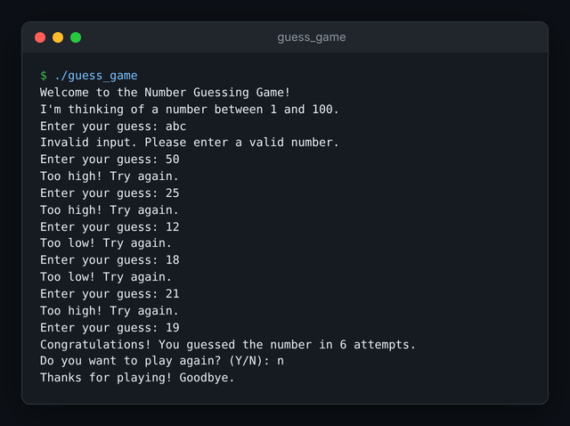

# 🎲 Secret Number Guessing Game

A console game in C++: the program picks a random number from 1 to 100 and you guess it with "too low / too high" hints.


## Screenshot

<p align="center">
  
</p>

<sub>A real session: non-numeric input is rejected, then the number is found in 6 guesses.</sub>

## Features

- Random secret number each round (`rand()` seeded with the current time).
- Hints after every guess and an attempt counter shown on success.
- Input validation: non-numeric input is rejected without crashing.
- Play-again prompt (`Y`/`N`).

## Run

Requires a C++ compiler (g++, clang++ or MSVC).

```bash
g++ -std=c++11 main.cpp -o guess_game
./guess_game
```

## Contributing

Issues and pull requests are welcome: fork, create a branch, and open a PR describing the change.

## Author

Sanket Mali · [GitHub](https://github.com/Sanket1516)
